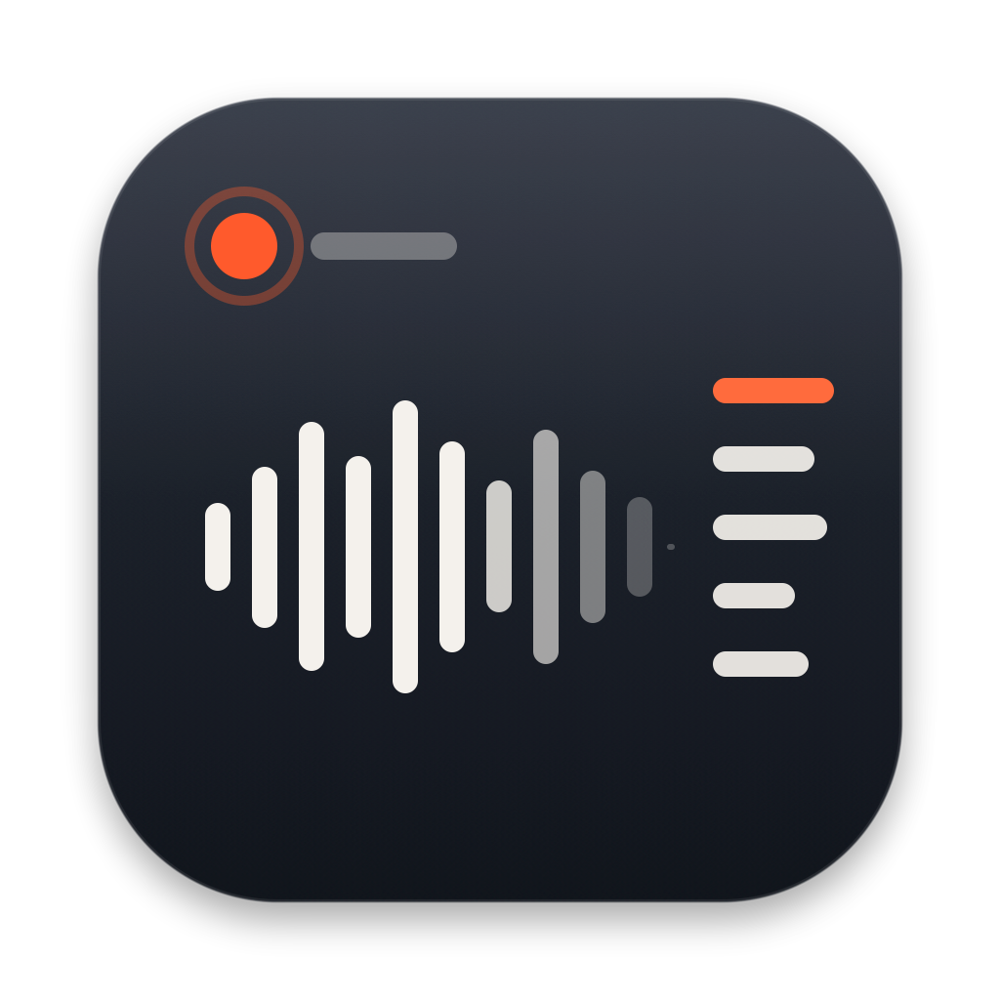

<p align="center"></p>

<h1 align="center">bili-podcast-notes</h1>

<p align="center">把 B站上的长播客、访谈变成详细、可以跳着读的笔记。<br>发一个链接给 Claude，得到一个排版好的网页版笔记和一个可以直接粘贴进 OneNote 的版本。</p>

---

## 它能做什么

一期几个小时的访谈，看不完、记不住、英文术语听不懂？把链接发给 Claude，它会：

1. **取文字稿**：优先用 UP主上传的字幕，其次用 B站 AI 字幕；都没有就下载音频，用本地的 Whisper 模型转写（全程在你的 Mac 上运行，不上传音频）。
2. **通读全文写笔记**：按章节、每 1–3 分钟一个要点，详细到基本可以代替看视频。
3. **把时间戳对准到原句**：每个要点都能点一下跳回视频里那句话的开头。
4. **事实核查**：联网核实嘉宾说的事实（收购、人事变动、数据……），标出属实、部分属实、不符或无法核实，并附上来源。
5. **生成两个版本**：网页版发布成 [Claude Artifact](https://claude.ai)（私人链接，手机也能看），OneNote 版放进剪贴板。
6. **汇总成知识库**：首页汇总所有期，可以搜索，自动对照不同嘉宾对同一家公司的看法，并追踪嘉宾做过的预测。

### 每期笔记包含

| 部分 | 内容 |
|---|---|
| 精华主题 | 几个问题读懂这期 |
| 跳着看指南 | 哪些片段必看、推荐、选看、可跳过，附一条按章节着色的“时码尺” |
| 时间线 | 分章节的详细要点，可以勾选“已读”、只看未读 |
| 核心观点 | 结论、论证、逻辑强弱、嘉宾立场（比如他在哪家公司工作） |
| 事实核查 | 嘉宾说的事实对照公开信息 |
| 和你有关 | 按你在 `config/profile.md` 里写的关注方向，整理相关观察，并追踪嘉宾的预测 |
| 观点速览 | 按公司 / 行业整理，可以按依据强弱筛选 |
| 英文对照 | 英文术语第一次出现时自动加中文注释；已认识的词点一下就不再显示 |
| 关键概念、金句、自测题 | 帮你消化和复习 |

## 需要什么

- **Apple 芯片（M 系列）的 Mac**：本地语音转写用的是 Apple 的 MLX 框架。
- **[Claude 桌面应用](https://claude.ai/download)**，使用其中的 Code 标签页。需要 Claude 账号，发布网页版用的是 Claude 的 Artifact 功能。
- **一个登录了 B站的浏览器**（Chrome、Edge、Safari、Firefox 都可以）。不登录时 B站会拒绝请求，工具会在本机读取这个浏览器里的 B站登录状态，不会发送到别处。
- 大约 **3 GB** 磁盘空间，用来放工具和语音模型。

不需要另外安装 Python、Homebrew 或 ffmpeg，`setup.sh` 会把所有工具都装进本文件夹的 `tools/` 里。

## 安装

```bash
git clone https://github.com/ljjjjj-dev/bili-podcast-notes.git
```

```bash
cd bili-podcast-notes && ./setup.sh
```

`setup.sh` 会：

1. 下载[独立版 Python 3.13](https://github.com/astral-sh/python-build-standalone)，并用官方 SHA256 校验；
2. 安装 yt-dlp、mlx-whisper、ffmpeg（约 1.3 GB）；
3. 下载 Whisper 语音模型 `mlx-community/whisper-large-v3-turbo`（约 1.5 GB）。如果只打算用 B站字幕，可以加 `--no-model` 先跳过，以后需要时再运行一次 `./setup.sh`。
4. 创建你的个人设置文件。

然后打开这两个文件，改成你自己的情况：

- `config/settings.json`：`output_dir` 是笔记存放的文件夹；`browser` 是你登录 B站用的浏览器（`chrome`、`edge`、`safari`、`firefox`）；`home_url` 先留空，第一次生成首页后 Claude 会自动填上。
- `config/profile.md`：你的阅读习惯、英文水平和关心的方向。Claude 写“和你有关”一节时会按这里写的来。

## 使用

1. 打开 Claude 桌面应用，切到 **Code** 标签页。
2. 新建会话，文件夹选这个仓库所在的文件夹。
3. 发 B站链接，比如“帮我总结 BV1xxxxxxx”。完整网址、BV 号、av 号、App 分享出来的整段文字都可以；多P视频说一下第几P。
4. 等待十几到几十分钟（4 小时的访谈大约要几十分钟）。完成后 Claude 会给你网页版链接和首页链接，并把 OneNote 版放进剪贴板，在 OneNote 新页面里按 `Cmd + V` 即可。

很重要的一期，可以说“用 Whisper 重新转写”，通常比 B站 AI 字幕更准。

## 工作原理

整个流程写在 [`CLAUDE.md`](CLAUDE.md) 里，Claude 在这个文件夹里工作时会自动读取。脚本只负责机械的部分，阅读理解和写作由 Claude 完成。

```
链接 ─▶ fetch.py   取视频信息和字幕，没有字幕就下载音频本地转写
     ─▶ Claude     通读文字稿，写 episode.json（结构化笔记），联网事实核查
     ─▶ align.py   用每个要点的“锚点句”把时间戳对准到字幕原句
     ─▶ build.py   生成网页版和 OneNote 版，自动给英文术语加中文注释
     ─▶ Claude     发布网页版为 Artifact
     ─▶ home.py    汇总所有期，生成知识库首页
     ─▶ clip.py    把 OneNote 版放进剪贴板
```

## 文件夹结构

```
bili-podcast-notes/
├── CLAUDE.md              给 Claude 的流程说明：步骤、数据格式、写作要求
├── setup.sh               一次性安装所有工具
├── requirements.txt       Python 包版本
├── scripts/
│   ├── fetch.py           取视频信息和字幕 / 本地转写
│   ├── align.py           时间戳对齐
│   ├── build.py           生成网页版和 OneNote 版
│   ├── home.py            生成知识库首页
│   ├── clip.py            放进 macOS 剪贴板（带格式）
│   ├── glossary.py        英文术语中文对照表（可以继续补充）
│   └── assets/            网页样式和交互
├── config/
│   ├── settings.example.json   个人设置模板
│   └── profile.example.md      个人情况模板
├── icon/                  图标
└── tools/                 由 setup.sh 安装，不在仓库里
```

## 常见问题

- **提示 412 / B站拒绝了请求**：在 `config/settings.json` 里写的那个浏览器中登录 B站，再试一次。第一次读取登录信息时，macOS 可能会弹窗请求访问钥匙串，点“允许”。
- **B站改版后取不到字幕**：更新 yt-dlp，运行 `tools/python/bin/python -m pip install -U yt-dlp`。
- **转写结果是重复的话或乱码**：语音识别遇到纯音乐会乱识别。播客、访谈这类以说话为主的内容不会这样。
- **想挪动文件夹**：可以直接挪，工具用的都是相对路径。

## 声明

- 本项目只是一个**个人学习用**的笔记工具。字幕、音频和视频内容的版权属于 B站和原作者。请只用于自己学习，不要传播下载的音视频，也不要把生成的笔记用于商业用途，并遵守 B站用户协议。
- 笔记内容由 AI 生成，可能有错误；“和你有关”一节里与投资相关的内容只是观察，**不构成投资建议**。
- 用到的第三方工具各自遵循它们的许可证：[yt-dlp](https://github.com/yt-dlp/yt-dlp)、[mlx-whisper](https://github.com/ml-explore/mlx-examples)、[Whisper](https://github.com/openai/whisper)、[python-build-standalone](https://github.com/astral-sh/python-build-standalone)、[FFmpeg](https://ffmpeg.org)（通过 imageio-ffmpeg）。

## 许可证

[MIT](LICENSE)
