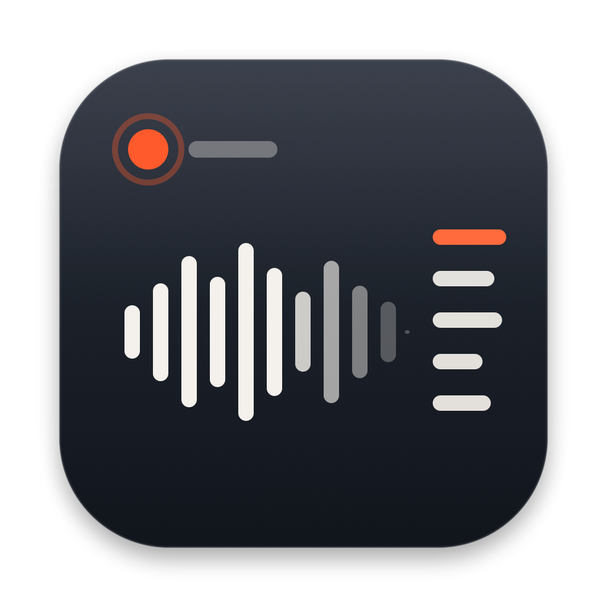
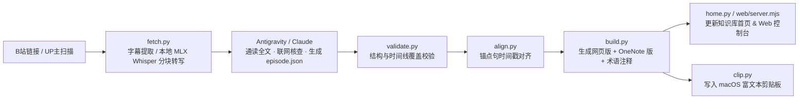

<p align="center">
  
</p>

<h1 align="center">bili-podcast-notes</h1>

<p align="center">
  把 B站长播客、深度访谈变成详细、可跳着读的结构化笔记与个人知识库。<br>
  发一个链接给 <strong>Antigravity</strong>（或 Claude Code），自动完成字幕获取 / 本地 MLX Whisper 转写、事实核查、时间戳对齐，并生成排版精美的网页版笔记、OneNote 版与本地 Web 控制台。
</p>

<p align="center">
  <a href="https://github.com/ljjjjj-dev/bili-podcast-notes/actions/workflows/ci.yml"></a>
  <a href="LICENSE"></a>
  
  
  
</p>

<p align="center">
  <a href="#功能">功能</a> •
  <a href="#安装">安装</a> •
  <a href="#使用">使用</a> •
  <a href="#本地-web-控制台">Web 控制台</a> •
  <a href="#工作原理">工作原理</a> •
  <a href="#目录结构">目录结构</a> •
  <a href="#常见问题">常见问题</a>
</p>

---

## 功能

一期几个小时的访谈，看不完、记不住、英文术语听不懂？把链接发给 Antigravity，它会：

1. **智能取文字稿**：优先使用 UP 主上传的字幕，其次用 B 站 AI 字幕；都没有则下载音频，在你的 Mac 上用本地 **MLX Whisper** 自动识别语言并分块转写（全程离线，不上传音频）。
2. **通读全文写笔记**：按章节、每 1–3 分钟一个要点，详细到基本可以代替看视频。
3. **时间戳精准对齐**：通过锚点句自动把每个要点的时间戳对准到字幕原句开头，点击直接跳回 B 站对应位置。
4. **联网事实核查**：核实嘉宾提到的收购、人事变动、数据等事实，标注「属实 / 部分属实 / 不符 / 无法核实」并附来源。
5. **双格式输出**：生成交互式本地网页版笔记，并将带格式的 OneNote 版自动写入剪贴板。
6. **个人知识库 & UP 主发现**：自动汇总所有已读期次，支持跨期搜索、同一公司多嘉宾观点对照、预测追踪，以及从订阅 UP 主自动扫描最新长播客候选。

### 每期笔记包含

| 模块 | 内容 |
|---|---|
| 精华主题 | 几个核心问题快速读懂全期 |
| 跳着看指南 | 标注「必看 / 推荐 / 选看 / 可跳过」片段，附按章节着色的可交互“时码尺” |
| 时间线 | 分章节详细要点，支持勾选“已读”与“只看未读” |
| 核心观点 | 结论、论证链条、逻辑强弱与嘉宾立场（利益相关性） |
| 事实核查 | 对照公开信息验证嘉宾陈述，附参考来源 |
| 和你有关 | 结合 `local/profile.md` 中的个人关注方向提炼观察，并追踪嘉宾预测 |
| 观点速览 | 按公司 / 行业聚合，支持按依据强弱筛选 |
| 英文对照 | 英文术语首次出现自动加中文注释；已掌握的词点击一次即可永久隐藏 |
| 关键概念、金句、自测题 | 辅助消化、复盘与记忆巩固 |

## 运行环境

- **Apple 芯片（M 系列）Mac**：本地语音转写基于 Apple MLX 框架（`mlx-whisper`）。
- **Antigravity**（配置 `bili-podcast-notes` 全局技能，亦兼容 Claude Code）。
- **已登录 B 站的浏览器**（Chrome / Edge / Safari / Firefox 均可）：仅在本机读取 Cookie 以避免 B 站限流，不会上传至任何第三方。
- **Node.js 18+**（仅在使用可选的本地 Web 控制台时需要）。
- 约 **3 GB** 磁盘空间，用于存放独立 Python 环境、ffmpeg 与 Whisper 模型。

> [!TIP]
> 无需提前安装 Python、Homebrew 或 ffmpeg，`setup.sh` 会将全部依赖隔离安装在本项目的 `tools/` 目录中。

## 安装

```bash
git clone https://github.com/ljjjjj-dev/bili-podcast-notes.git
cd bili-podcast-notes
./setup.sh
```

`setup.sh` 会自动完成：

1. 下载[独立版 Python 3.13](https://github.com/astral-sh/python-build-standalone) 并校验官方 SHA256；
2. 安装 `yt-dlp`、`mlx-whisper`、`imageio-ffmpeg`（约 1.3 GB）；
3. 下载语音模型 `mlx-community/whisper-large-v3-turbo`（约 1.5 GB；若暂只需 B 站字幕，可加 `--no-model` 跳过，后续随时重跑 `./setup.sh` 补装）；
4. 在 `local/` 目录初始化个人配置模板（`local/` 已加入 `.gitignore`，不会提交到公开仓库；如需备份，可在 `local/` 内单独 `git init` 并推送到私有仓库）。

完成后按需编辑 `local/` 下的个人配置：

- `local/settings.json`：
  - `output_dir`：笔记输出目录（支持绝对路径，也支持相对于项目根目录的相对路径，例如 `"data"`）；
  - `browser`：登录 B 站的浏览器（`chrome` / `edge` / `safari` / `firefox`）；
  - `home_url`：可留空（本地 `首页.html` 会自动链接到各期 `网页版.html`）；
  - `tools_dir`（可选）：如果将 `tools/` 放在外部共享目录，可在此指定路径。
- `local/profile.md`：填写你的背景、阅读偏好、英文水平和关注领域，AI 生成“和你有关”一节时会据此定制。
- `local/channels.json`（可选，参考 `config/channels.example.json`）：配置你订阅的 B 站 UP 主列表，供 `scripts/discover.py` 和 Web 控制台自动扫描最新长播客。

## 使用

1. 打开 **Antigravity**（任意工作区均可）。
2. 发送 B 站链接，例如：`帮我总结 BV1xxxxxxx`。支持完整网址、BV 号、av 号、App 分享文案；多 P 视频说明第几 P 即可。
3. 生成完成后，直接点击返回的 `网页版.html` 或 `首页.html` 阅读；同时 OneNote 版已自动写入剪贴板，在 OneNote 新页面按 `Cmd + V` 即可粘贴。

> [!NOTE]
> 遇到特别重要或 B 站 AI 字幕质量较差的视频，可以直接说「用 Whisper 重新转写」，本地模型通常准确率更高，且自动支持中英文识别。

## 本地 Web 控制台

内置零依赖 Node.js 控制台，提供一站式可视化体验：

```bash
node web/server.mjs
```

启动后访问 `http://127.0.0.1:3457`（可通过环境变量 `PORT=xxxx` 自定义端口），支持：

- **精读库与每日精选**：浏览所有已生成笔记，内置 Markdown 阅读器，一键复制 OneNote 格式；
- **跨期观点与预测追踪**：聚合不同嘉宾对同一家公司 / 行业的判断；
- **订阅 UP 主扫描**：在线调用 `discover.py` 拉取最新长视频候选并筛选；
- **配置管理 & 亮/暗主题切换**：可视化编辑订阅频道与基础设置。

## 工作原理

完整流程规范定义在 [`CLAUDE.md`](CLAUDE.md) 中：脚本负责确定性的工程环节，阅读理解、深度提炼与事实核查交由 AI Agent 完成。



## 目录结构

```text
bili-podcast-notes/
├── CLAUDE.md                    流程规范：步骤、JSON Schema 与写作要求
├── setup.sh                     一键隔离安装 Python / yt-dlp / MLX Whisper
├── requirements.txt             Python 依赖锁定
├── scripts/
│   ├── discover.py              从订阅 UP 主自动拉取最新长播客候选
│   ├── fetch.py                 取视频信息与字幕 / 本地长音频分块转写
│   ├── validate.py              校验 episode.json 结构、时间线与覆盖密度
│   ├── align.py                 锚点句时间戳精准对齐
│   ├── build.py                 生成网页版与 OneNote 版，自动加术语注释
│   ├── home.py                  汇总所有期次，生成知识库首页
│   ├── clip.py                  写入 macOS 富文本剪贴板
│   ├── glossary.py              英文术语中文对照表（持续扩充）
│   └── assets/                  网页版样式与交互脚本
├── web/
│   ├── server.mjs               零依赖 Node.js 本地服务
│   └── public/                  Web 控制台前端静态资源
├── config/
│   ├── settings.example.json    基础设置模板
│   ├── profile.example.md       个人背景与关注方向模板
│   └── channels.example.json    订阅 UP 主列表模板
├── icon/                        项目图标（PNG / SVG）
├── local/                       个人配置与私有数据（已 gitignore）
└── tools/                       独立运行时与模型（由 setup.sh 安装，已 gitignore）
```

## 常见问题

- **提示 412 / B 站拒绝请求**：在 `local/settings.json` 指定的浏览器中重新登录 B 站后再试。首次读取 Cookie 时 macOS 会请求访问钥匙串，点击「允许」即可。
- **B 站改版导致取不到字幕**：升级内置 `yt-dlp`：
  ```bash
  tools/python/bin/python -m pip install -U yt-dlp
  ```
- **转写出现重复片段或乱码**：Whisper 遇到纯背景音乐时可能产生幻觉，语音为主的播客与访谈通常不受影响。
- **移动项目文件夹**：脚本与 Web 控制台均支持相对路径与外部 `tools_dir`，直接移动目录即可，无需重装。

## 声明

- 本项目仅用于**个人学习与研究**，与哔哩哔哩（Bilibili）无任何关联。视频、音频及字幕版权归原平台与创作者所有，请勿传播下载的媒体文件或将生成内容用于商业用途，并遵守平台用户协议。
- 笔记与核查结果由 AI 生成，可能存在误差；“和你有关”中涉及行业或公司的观察仅作信息整理，**不构成任何投资建议**。
- 第三方组件各自遵循其开源协议：[yt-dlp](https://github.com/yt-dlp/yt-dlp)、[mlx-whisper](https://github.com/ml-explore/mlx-examples)、[Whisper](https://github.com/openai/whisper)、[python-build-standalone](https://github.com/astral-sh/python-build-standalone)、[FFmpeg](https://ffmpeg.org)（通过 `imageio-ffmpeg`）。

## 维护与致谢

- 初始架构与核心脚本由 **Claude Code** 协助构建。
- 2026-11-18 起由 **Antigravity** 接手维护与迭代，陆续新增：本地网页版直链与回退跳转、`validate.py` 质量校验、`discover.py` UP 主自动发现、长视频分块转写与多语言自动检测、零依赖 Web 控制台以及相对路径 / 外置 `tools_dir` 支持。

## 许可证

[MIT](LICENSE)
